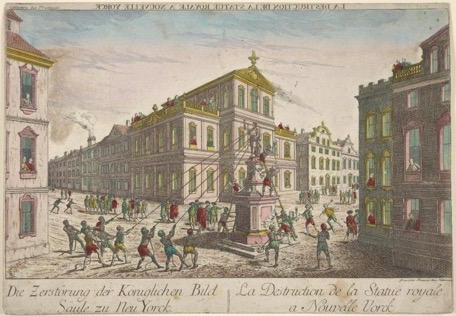

### Journée Publications récentes RéDEHJA
20/11/2026
Sorbonne Université

Journée organisée avec le soutien du laboratoire HDEA, du RéDEHJA et de la mention Master LLCER de Sorbonne Université

Comité d’organisation : Nathalie Caron (Sorbonne Université, HDEA), Robert Coatsworth (Sorbonne Université, HDEA), Gabrielle Guillerm (Sorbonne Université, HDEA), Maïann Stachnik (Sorbonne Université, HDEA)

Contact : nathalie.caron [at] sorbonne-universite.fr ; gabrielle.guillerm [at] sorbonne-universite.fr

# Programme

9h00 : Accueil

## MATIN - Session spéciale « Révolution américaine »

-	9h15 : Ouverture
-	9h30-10h45 : Bertrand Van Ruymbeke (Université Paris 8), 1776, *L’année américaine*, Tallandier, 2026 et Carine Lounissi (Université de Rouen Normandie), Eric Schnackenbourg (Nantes Université) et Bertrand Van Ruymbeke (Université Paris 8), *Révolution américaine et naissance des États-Unis (1763-1800)*, Armand Colin, 2026
o	Commentaire de Jean-François Dunyach (Sorbonne Université)

*10h45-11h15 :  Pause*

-	11h15-12h : Florence Petroff (La Rochelle Université), *La Révolution américaine et l'Ecosse: Regards croisés et identités hybrides*, Honoré Champion, 2026
o	Commentaire de Will Slauter (Sorbonne Université)

-	12h-12h45 : Agnès Delahaye (Université Lyon 2), *À qui appartient le 4 juillet ? L'indépendance américaine et sa mémoire*
o	Commentaire d'Anne-Claire Faucquez (Université Paris 8)

12h45-14h15 : Déjeuner

## APRES-MIDI

-	14h15-15h: Claire Bourhis-Mariotti (Université Paris 8), *We Are American Citizens: The Colored Conventions Movement and the Long Struggle for Civil Rights*, University of Georgia Press, 2026
o	Commentaire de Claire Parfait (Université Paris Nord)

-	15h-15h45 : Louis Bissières (Université Sorbonne Nouvelle), *Une économie de réseau : Explorer le monde marchand de Philadelphie*, Presses universitaires François-Rabelais, 2026
o	Commentaire de Nicolas Barreyre (EHESS)

*15h45-16h : Pause*

-	16h00-16h45 : Virginie Adane (Nantes Université), *Des femmes en Amérique : une histoire des États-Unis de Pocahontas à #MeToo*, Perrin, 2025
o	Commentaire d'Hélène Quanquin (Université de Lille)

-	16h45-17h00 : Conclusion

### [Télécharger le programme](Prog_Redehja2026.pdf)

Illustration: *La destruction de la statue royale à Nouvelle York*, The New York Public Library Digital Collections
